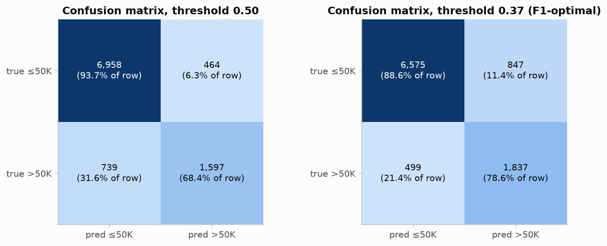
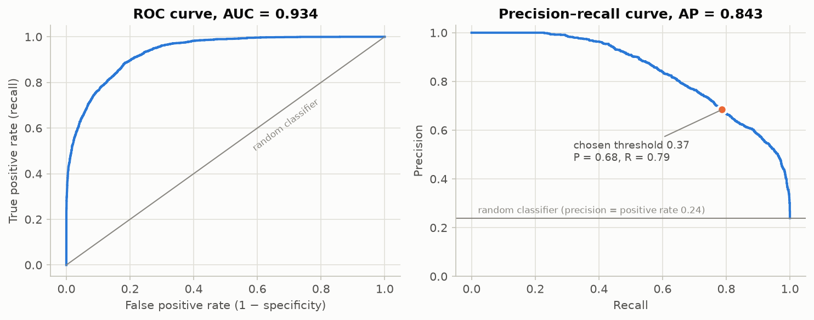

# Assignment 1: End-to-End Machine Learning Pipeline

**Question:** Download a suitable prediction dataset from the UCI Machine Learning Repository and build a complete machine learning pipeline.

**Dataset:** [UCI Adult (Census Income)](https://archive.ics.uci.edu/dataset/2/adult), 48,842 records with 14 attributes.
**Task:** binary classification. Does a person earn more than $50K per year?

## Files

| File | Contents |
|---|---|
| `Assignment_01_End_to_End_ML_Pipeline.ipynb` | Main submission. Fully executed notebook with code, outputs, explanations and conclusion |
| `Assignment_01_End_to_End_ML_Pipeline.html` | The same notebook rendered as HTML (opens in any browser) |
| `data/` | Raw UCI files (`adult.data`, `adult.test`, `adult.names`) |
| `figures/` | Every plot in the notebook, saved as PNG |
| `results/` | `cv_model_comparison.csv`, `test_metrics.csv`, `summary.json` |
| `models/adult_income_pipeline.joblib` | The trained end-to-end pipeline (preprocessing + model + threshold) |

## How to run

```bash
pip install -r requirements.txt
jupyter notebook Assignment_01_End_to_End_ML_Pipeline.ipynb    # then: Run All
```

If `data/` is missing, the notebook downloads the dataset from UCI. A full run takes about 5 minutes on a laptop CPU, mostly the hyperparameter search.

## Pipeline

```
raw files → clean → stratified 80/20 split → ColumnTransformer → classifier → evaluation → saved model
```

| Requirement | What was done |
|---|---|
| **Data cleaning, missing and inconsistent values** | Stripped whitespace. Converted 6,465 hidden `"?"` entries to missing values. Merged four inconsistent target labels (`"<=50K"`, `"<=50K."`, …) into 0/1. Removed 52 duplicate records. Dropped the redundant `education` column and the non-predictive `fnlwgt`. Missing `workclass`/`occupation` were shown to be *not random*, so they were imputed as an explicit `"Unknown"` category. |
| **Categorical encoding and feature scaling** | One-hot encoding for the 7 nominal columns (rare levels grouped, unseen levels handled). Ordinal `education_num` kept. `log1p` plus `StandardScaler` for the very skewed capital columns. `StandardScaler` for the other numeric columns. Everything is fitted inside one `Pipeline`, so nothing leaks from the test set. |
| **Train a suitable model** | 5-fold CV comparison of a majority baseline, Logistic Regression, Random Forest and Histogram Gradient Boosting. The best one (HGB) was tuned with `RandomizedSearchCV`, and the decision threshold was tuned on out-of-fold predictions. |
| **Evaluate and explain each metric** | Accuracy, balanced accuracy, precision, recall, F1, ROC-AUC, PR-AUC and confusion matrix. Each one is defined and interpreted for this problem. |
| **Code, results, conclusion** | Notebook plus `results/` plus the conclusion below |

## Results

5-fold cross-validation on the training set:

| Model | ROC-AUC | PR-AUC | F1 | Accuracy |
|---|---|---|---|---|
| Majority baseline | 0.500 | 0.239 | 0.000 | 0.761 |
| Logistic Regression | 0.899 | 0.737 | 0.644 | 0.845 |
| Random Forest | 0.918 | 0.804 | 0.682 | 0.863 |
| **Hist Gradient Boosting** | **0.927** | **0.825** | **0.707** | **0.871** |

Held-out test set (9,758 people), tuned HGB, threshold 0.37:

| Accuracy | Balanced acc. | Precision | Recall | F1 | ROC-AUC | PR-AUC |
|---|---|---|---|---|---|---|
| 0.862 | 0.836 | 0.684 | 0.786 | 0.732 | 0.934 | 0.843 |




## Conclusion

The pipeline turns messy raw census files into a robust classifier. The most important cleaning insight was that missing values were hidden as `"?"` and were **not random**, so keeping "missing" as its own category preserved real signal. Tuned gradient boosting separates high and low earners very well: ROC-AUC is 0.93, and PR-AUC is 0.84 against a random baseline of 0.24. Because the classes are imbalanced (24% earn >50K), accuracy alone is misleading. Always predicting "≤50K" already scores 76%, so the model is judged mainly on F1, ROC-AUC and PR-AUC. Lowering the decision threshold from 0.5 to 0.37 raises recall from 68% to 79% for a moderate loss in precision, which gives the best F1. The most influential features are marital status, capital gains, age and education.

**Limitations:** the data is from the 1994 census, and it contains sensitive attributes (sex, race). A fairness audit would be needed before any real-world use.
