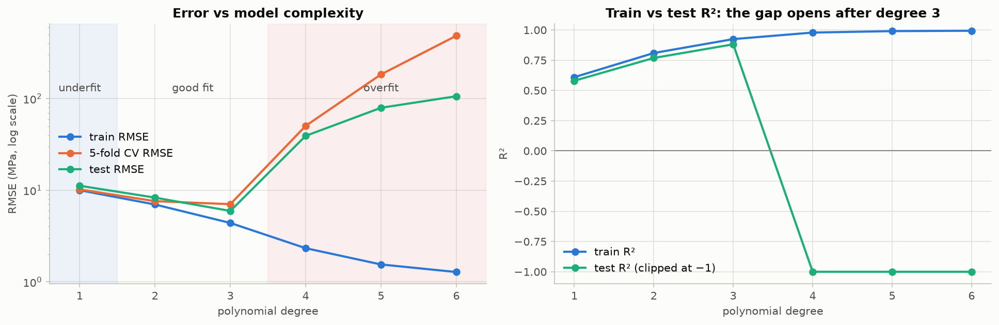
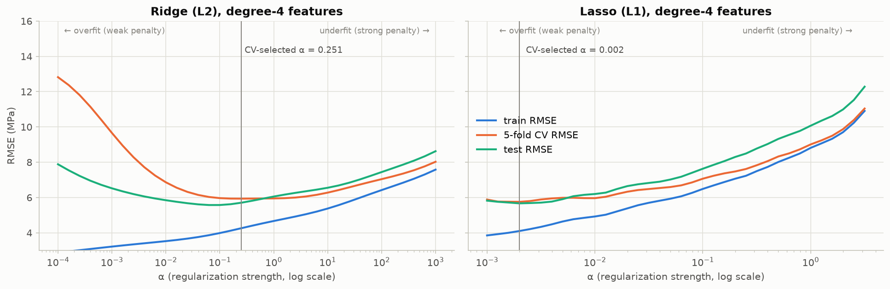

# Assignment 2: Non-Linear Regression and Regularization

**Question:** Select a non-linear dataset from UCI or Kaggle and investigate how regression complexity and regularization affect model performance.

**Dataset:** [UCI Concrete Compressive Strength](https://archive.ics.uci.edu/dataset/165/concrete+compressive+strength), 1,030 concrete mixes (1,005 after removing duplicates). Inputs are 7 ingredient amounts (kg/m³) plus age (days); the target is compressive strength (MPa).
**Why it is non-linear:** strength rises steeply with age and then plateaus, and it depends on the water/cement *ratio* and on interactions between ingredients.

## Files

| File | Contents |
|---|---|
| `Assignment_02_NonLinear_Regression_Regularization.ipynb` | Main submission. Executed notebook with code, outputs, explanations and conclusion |
| `Assignment_02_NonLinear_Regression_Regularization.html` | Rendered HTML version |
| `data/` | Original UCI file (`Concrete_Data.xls`) and its readme |
| `figures/` | All plots (PNG) |
| `results/` | `polynomial_degree_comparison.csv`, `final_model_comparison.csv` |

## How to run

```bash
pip install -r requirements.txt
jupyter notebook Assignment_02_NonLinear_Regression_Regularization.ipynb    # Run All, takes about 4 minutes
```

## Method

* 80/20 train/test split. Every model choice (polynomial degree, α) uses **5-fold CV on the training set**; the test set is only used to report results.
* Pipeline: `PolynomialFeatures(d) → StandardScaler → LinearRegression / Ridge / Lasso`.
* Ridge and Lasso are tuned over 36 α values each, with the polynomial expansion and scaler refitted inside every CV fold, so no information leaks between folds.

## Results (test set)

| Model | Features (non-zero) | Train R² | Test R² | Test MSE | Test RMSE (MPa) | Diagnosis |
|---|---|---|---|---|---|---|
| Linear Regression | 8 | 0.61 | 0.58 | 125.3 | 11.19 | underfitting |
| Polynomial degree 2 | 44 | 0.81 | 0.77 | 69.0 | 8.31 | still biased |
| Polynomial degree 3 | 164 | 0.93 | 0.88 | 35.3 | 5.94 | best unregularized model |
| Polynomial degree 4 | 494 | 0.98 | **−4.15** | 1535.7 | 39.19 | severe overfitting |
| Degree 4 + **Ridge** (α = 0.25) | 494 | 0.93 | **0.89** | 32.6 | **5.71** | regularized |
| Degree 4 + **Lasso** (α = 0.002) | 494 (161) | 0.94 | **0.89** | 32.2 | **5.67** | regularized and sparse |




## Conclusion

* **Linear Regression underfits.** Test R² is 0.58, and the residuals follow a systematic arch against age.
* **Polynomial features reduce the bias.** Degree 3 is the sweet spot without regularization (R² 0.88). From **degree 4 onward the model overfits**: training R² goes to about 0.99, while test R² becomes negative, i.e. worse than predicting the mean.
* **Ridge and Lasso rescue the overfit degree-4 model.** Test R² goes from −4.15 to 0.89, which beats the best unregularized model. The penalty shrinks the coefficients from a maximum of about 12,500 to a few dozen.
* **Ridge vs Lasso:** their accuracy is tied. Ridge keeps every term with small weights. Lasso additionally discards two thirds of the terms (161 of 494 kept), which gives a sparser, more interpretable model, and it has the lowest CV error.
* **Take-away:** choose complexity by validation error, never by training error. A flexible model with tuned regularization generalizes better than one whose capacity is cut by hand.
