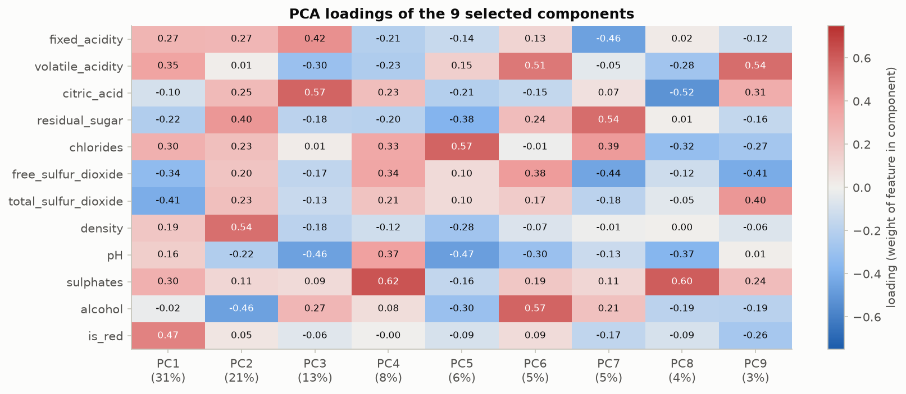
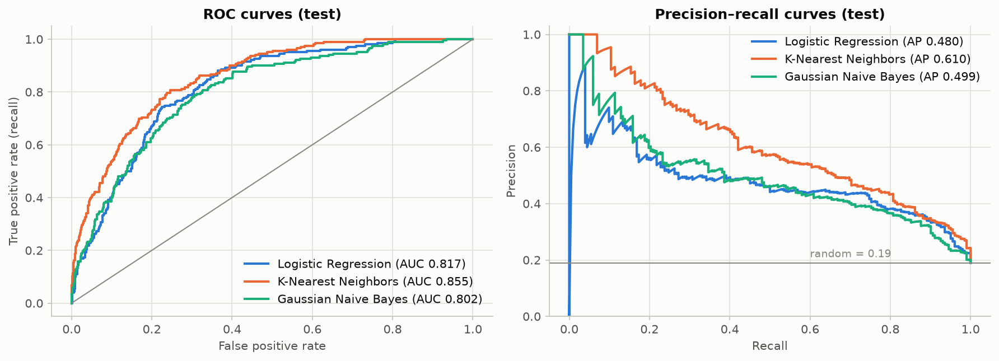

# Assignment 3: PCA and Model Comparison

**Question:** Use the Wine Quality dataset to study dimensionality reduction and compare multiple classification algorithms.

**Dataset:** [UCI Wine Quality](https://archive.ics.uci.edu/dataset/186/wine+quality), 6,497 red and white *Vinho Verde* wines with 11 physicochemical features and a quality score. I add an `is_red` indicator.
**Task:** binary classification, **high quality (score ≥ 7)** vs not. About 19% of wines are high quality.

## Files

| File | Contents |
|---|---|
| `Assignment_03_PCA_Model_Comparison.ipynb` | Main submission. Executed notebook with code, outputs, explanations and conclusion |
| `Assignment_03_PCA_Model_Comparison.html` | Rendered HTML version |
| `data/` | Original UCI CSV files |
| `figures/` | All plots (PNG) |
| `results/` | Test metrics (tuned and 0.5 thresholds), repeated-CV stability |

## How to run

```bash
pip install -r requirements.txt
jupyter notebook Assignment_03_PCA_Model_Comparison.ipynb    # Run All, takes under 1 minute
```

## What was done

| Requirement | Implementation |
|---|---|
| Clean the data and apply Standard Scaling | Checked types, missing and impossible values (none). **Removed 1,177 duplicate wines (18%)** so identical rows could not appear in both train and test. Outliers were inspected and kept, after showing that clipping them had no effect. `StandardScaler` is fitted on the training set only. |
| PCA and explanation of components | **9 of 12 components retain 96.6% of the variance**, which is also where all three models plateau. PC1 is the red-vs-white winemaking axis, PC2 is alcohol vs density/sugar (the axis most related to quality), PC3 is acidity, and PC4 is sulphates. |
| Train LR, KNN, Naive Bayes | Pipeline `StandardScaler → PCA(9) → model`, hyperparameters tuned by 5-fold CV (ROC-AUC). Each model's decision threshold is tuned on out-of-fold training predictions. |
| Compare with suitable metrics | ROC-AUC, PR-AUC, F1, precision, recall, balanced accuracy and accuracy, plus confusion matrices and 5×5 repeated CV for stability. |
| Identify and justify the best model | See below |

## Results (held-out test set, 1,064 wines)

| Model | ROC-AUC | PR-AUC | F1 | Precision | Recall | Balanced acc. | Repeated-CV ROC-AUC |
|---|---|---|---|---|---|---|---|
| Logistic Regression | 0.817 | 0.480 | 0.536 | 0.418 | **0.748** | 0.752 | 0.828 ± 0.014 |
| **K-Nearest Neighbors** (k = 51, distance-weighted) | **0.855** | **0.610** | **0.574** | **0.488** | 0.698 | **0.763** | **0.838 ± 0.013** |
| Gaussian Naive Bayes | 0.802 | 0.499 | 0.502 | 0.420 | 0.624 | 0.711 | 0.808 ± 0.021 |




## Conclusion

**K-Nearest Neighbors is the best-performing model.** It is best on every threshold-independent metric, both on the test set and across 25 repeated-CV folds. It also has the highest F1 and balanced accuracy, and better precision than Logistic Regression, which only reaches higher recall by flagging many more ordinary wines. KNN's local, non-linear decision rule suits this data, where red and white wines form separate chemical clusters and "premium" looks different in each.

PCA reduced the input from 12 to 9 dimensions at almost no cost for Logistic Regression and KNN (≤ 0.003 AUC), and it *improved* Naive Bayes by about 0.03 AUC, because decorrelated components satisfy its independence assumption.

**Limitation:** quality is a sensory judgement, and the dataset only has lab measurements, so premium detection stays moderately difficult (F1 ≈ 0.57).
