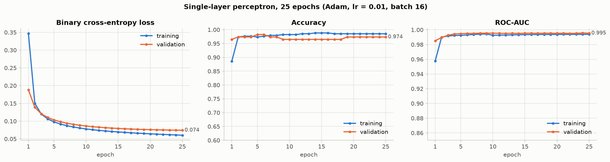

# Assignment 5: Single-Layer Perceptron (TensorFlow / Keras)

**Question:** Create and train a Single-Layer Perceptron using TensorFlow and Keras.

**Dataset:** [Breast Cancer Wisconsin (Diagnostic)](https://archive.ics.uci.edu/dataset/17/breast+cancer+wisconsin+diagnostic), UCI (bundled with scikit-learn). 569 tumours, 30 numeric features, **binary target: malignant (1) vs benign (0)**.

## Files

| File | Contents |
|---|---|
| `Assignment_05_Single_Layer_Perceptron.ipynb` | Main submission. Executed notebook with code, outputs, explanations and conclusion |
| `Assignment_05_Single_Layer_Perceptron.html` | Rendered HTML version |
| `figures/` | Training curves, confusion matrix, learned weights, experiments, decision boundary |
| `results/` | `training_history.csv` (all 25 epochs), `test_metrics.csv` |

## How to run

```bash
pip install -r requirements.txt
jupyter notebook Assignment_05_Single_Layer_Perceptron.ipynb    # Run All, takes under 1 minute on CPU
```

## Model

```
30 standardised inputs ──► Dense(1, activation="sigmoid") ──► P(malignant)
```

| Component | Choice |
|---|---|
| Architecture | one neuron, 30 weights + 1 bias = **31 parameters** |
| Activation | **sigmoid**: outputs a probability and is differentiable |
| Loss | **binary cross-entropy** |
| Optimizer | **Adam**, learning rate 0.01 |
| Training | **25 epochs**, batch size 16, 60/20/20 stratified train/val/test split |

## Results

| Metric (114 test tumours) | Value |
|---|---|
| Accuracy | **96.5%** |
| Precision | 0.952 |
| Recall (sensitivity) | 0.952 (40 of 42 malignant detected) |
| F1 | 0.952 |
| ROC-AUC | 0.996 |



## Roles of the main components (full explanation in Section 7 of the notebook)

* **Activation function:** turns the neuron's weighted sum into its output. Sigmoid maps it to a probability in (0, 1). Unlike Rosenblatt's step function it is differentiable, so gradient descent works. The notebook shows that a step-function perceptron oscillates and gives no confidence scores.
* **Loss function:** measures how wrong the predictions are. Binary cross-entropy is the negative log-likelihood of a 0/1 label, punishes confident mistakes heavily, and makes the problem convex for a single sigmoid neuron.
* **Optimizer:** uses the gradients to update the weights. In 25 epochs, Adam and RMSprop converge much faster than plain SGD (shown experimentally).
* **Epochs:** the number of full passes over the training data (here 25 × 22 mini-batches = 550 updates). Too few epochs underfit and too many overfit. A 150-epoch run shows that 25 is close to the validation-loss optimum (epoch 32), and that much longer training starts to overfit mildly.

## Conclusion

A single neuron with sigmoid activation, binary cross-entropy and Adam learns to separate malignant from benign tumours with 96.5% test accuracy and 0.996 ROC-AUC in 25 epochs, with training and validation curves close together. It works because the data is nearly linearly separable. Its limitation is that it can only learn a linear decision boundary (shown in a 2-feature plot), which is the motivation for multi-layer perceptrons.
