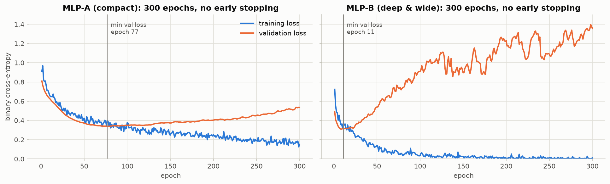

# Assignment 6: MLP for Heart Disease Prediction

**Question:** Download the Heart Disease dataset and compare two Multi-Layer Perceptron architectures.

**Dataset:** [UCI Heart Disease, Cleveland subset](https://archive.ics.uci.edu/dataset/45/heart+disease) (`processed.cleveland.data`). 303 patients with 13 clinical attributes. Target: heart disease **present (num ≥ 1) vs absent (num = 0)**, giving 139 vs 164 patients.

## Files

| File | Contents |
|---|---|
| `Assignment_06_MLP_Heart_Disease.ipynb` | Main submission. Executed notebook with code, outputs, explanations and conclusion |
| `Assignment_06_MLP_Heart_Disease.html` | Rendered HTML version |
| `data/` | `processed.cleveland.data` and the UCI attribute description |
| `figures/` | EDA, learning curves, confusion matrices, CV comparison |
| `results/` | Test metrics, 25-fold scores per architecture, paired statistical comparison |

## How to run

```bash
pip install -r requirements.txt
jupyter notebook Assignment_06_MLP_Heart_Disease.ipynb    # Run All, takes about 5 minutes on CPU
```

## Preprocessing and split

* `"?"` → missing (6 values, in `ca` and `thal`). Imputation (median / most frequent) is fitted on training data only.
* Numeric features are standardised. Nominal features (`cp`, `restecg`, `slope`, `thal`) are **one-hot encoded** with fixed category lists. Binary features pass through. This gives 22 network inputs.
* Stratified split: **train 193 / validation 49 / test 61**. Validation is used for early stopping and the test set only for the final evaluation.

## The two architectures

| | MLP-A (compact) | MLP-B (deep & wide) |
|---|---|---|
| Hidden layers | 16 → 8 | 128 → 64 → 32 |
| Parameters | 513 | 13,313 |
| Shared settings | ReLU, He init, dropout 0.2, sigmoid output, Adam (1e-3), binary cross-entropy, batch 16, early stopping (patience 30) | same |

## Results

Held-out test set (61 patients):

| | Accuracy | Precision | Recall | F1 |
|---|---|---|---|---|
| **MLP-A** | **0.885** | **0.862** | 0.893 | **0.877** |
| MLP-B | 0.869 | 0.813 | **0.929** | 0.867 |

Repeated 5×5 stratified CV (25 paired folds on the development set):

| | Accuracy | Precision | Recall | F1 |
|---|---|---|---|---|
| **MLP-A** | 0.809 ± 0.060 | 0.822 ± 0.094 | 0.756 ± 0.074 | 0.785 ± 0.064 |
| MLP-B | 0.806 ± 0.060 | 0.813 ± 0.094 | 0.762 ± 0.083 | 0.782 ± 0.065 |

None of the differences is statistically significant (Wilcoxon signed-rank, all p ≥ 0.37).



## Conclusion

**MLP-A (compact) is the better architecture.** Both networks reach the same predictive performance: differences are under one point on all four metrics across 25 paired folds, with no statistically significant difference. MLP-A gets there with **26× fewer parameters**, and it is far more robust. Without early stopping, MLP-B memorises the 193 training patients (training loss → 0.009, validation loss → 1.35 after a minimum at epoch 11), while MLP-A degrades only gently. On a small tabular dataset the extra depth and width mainly fit noise, so the simpler model is preferred. If higher sensitivity is needed clinically, MLP-A's decision threshold can be lowered.
