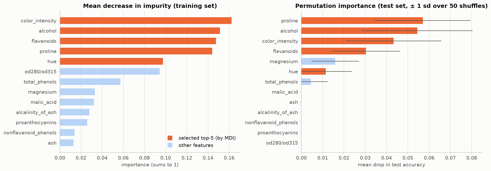
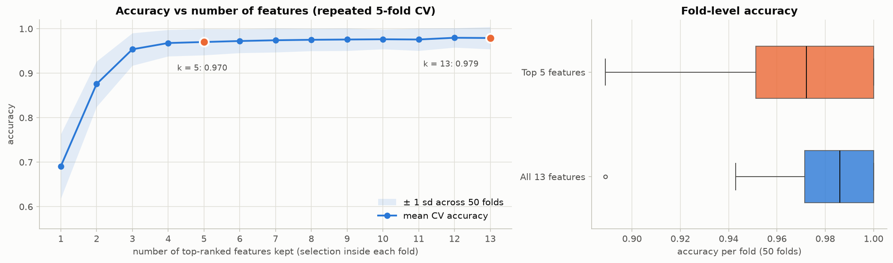

# Assignment 7: Random Forest Feature Selection

**Question:** Use Random Forest to perform feature selection and measure the effect of using only the most important features.

**Dataset:** [UCI Wine](https://archive.ics.uci.edu/dataset/109/wine) (bundled with scikit-learn). 178 wines from 3 cultivars, 13 chemical measurements. (The assignment allowed Wine or IBM HR Attrition. I chose Wine because all of its features are interpretable chemical measurements.)

## Files

| File | Contents |
|---|---|
| `Assignment_07_Random_Forest_Feature_Selection.ipynb` | Main submission. Executed notebook with code, outputs, explanations and conclusion |
| `Assignment_07_Random_Forest_Feature_Selection.html` | Rendered HTML version |
| `figures/` | Feature importance, cumulative importance, confusion matrices, accuracy vs number of features, scatter plots |
| `results/` | `model_comparison.csv`, `accuracy_vs_n_features.csv` |

## How to run

```bash
pip install -r requirements.txt
jupyter notebook Assignment_07_Random_Forest_Feature_Selection.ipynb    # Run All, takes about 2 minutes
```

## Method

1. Stratified 70/30 split (124 train / 54 test).
2. **Baseline Random Forest** (500 trees) on all 13 features.
3. **Feature importance** by mean decrease in impurity on the training set, cross-checked with permutation importance on the test set (Spearman ρ = 0.84 between the two rankings).
4. **Top 5 features:** colour intensity, alcohol, flavanoids, proline, hue. Together they hold 70% of the total importance.
5. Retrain the forest on the top 5 and compare. Because 54 test wines are too few to separate two near-perfect models, the comparison also uses **repeated 5-fold CV (50 folds) with the feature selection redone inside every fold**, which avoids selection bias.

## Results

| | All 13 features | Top 5 features |
|---|---|---|
| Test accuracy / macro-F1 | 1.000 / 1.000 | 1.000 / 1.000 |
| OOB accuracy | 0.976 | 0.952 |
| **Repeated-CV accuracy** | **0.979 ± 0.025** | 0.970 ± 0.030 |
| Repeated-CV log-loss (lower is better) | 0.139 | **0.126** |
| Measurements needed per wine | 13 | **5 (−62%)** |
| Total tree nodes / model size | 8,976 / 928 KB | 8,244 / 865 KB |




## Conclusion

* **Accuracy:** dropping 8 of 13 features costs **less than one point** of cross-validated accuracy (97.9% → 97.0%), and test accuracy stays at 100%. Accuracy plateaus after 4–5 features, and the top-5 model's probability estimates are even slightly better (lower log-loss).
* **Simplicity:** the model needs only **5 measurements instead of 13**, so data collection is cheaper and there are fewer failure points. The forest itself barely shrinks (−8% nodes), because fully grown trees grow until their leaves are pure whatever the number of features.
* **Interpretability:** five meaningful chemical features can be visualised directly, and a single depth-3 decision tree on them gives human-readable rules (98.1% test / 92.6% CV accuracy).

**Recommendation:** the top-5 model is the better practical choice. It is almost as accurate as the full model while being much simpler and easier to explain.
