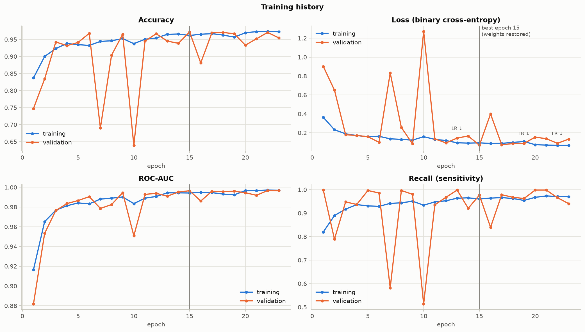
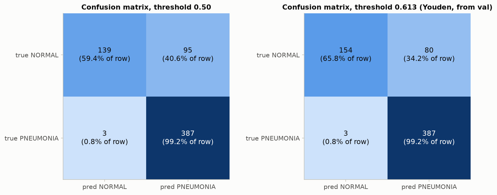

# Assignment 8 — Pneumonia Detection using a CNN

A Convolutional Neural Network, designed and trained from scratch, that classifies paediatric chest X-ray images as **Pneumonia Positive** or **Pneumonia Negative (normal)**.

Everything (download, data organisation, training, plots and evaluation) is in one notebook:
**[`Assignment_08_Pneumonia_CNN.ipynb`](Assignment_08_Pneumonia_CNN.ipynb)**. An HTML export with all outputs, [`Assignment_08_Pneumonia_CNN.html`](Assignment_08_Pneumonia_CNN.html), can be opened in any browser without Python.

## Requirements covered

| Requirement | Where | What was done |
|---|---|---|
| Download and organise the Kaggle Pneumonia Chest X-Ray dataset | Notebook §1 | Downloaded with `kagglehub`. The 16-image official validation set is replaced by a **patient-grouped, class-stratified** re-split of train+val (no child appears in both train and validation). The official test set is kept as the hold-out. Written to `data/chest_xray_organized/{train,val,test}/{NORMAL,PNEUMONIA}/` plus `data/manifest.csv`. |
| Create your own CNN architecture | Notebook §3 | 4 convolution blocks (32 → 64 → 128×2 → 256×2 filters), Global Average Pooling and a small dense head, about 1.16 M parameters, no pre-trained weights |
| Batch Normalization, Dropout, Data Augmentation | Notebook §2.3, §3 | BatchNorm after every convolution; Dropout 0.5 and 0.3 in the classifier head; random rotation, zoom, translation and contrast (no horizontal flip, because chest anatomy is asymmetric) |
| Train and visualise accuracy and loss | Notebook §4 | Adam, class-weighted binary cross-entropy, ReduceLROnPlateau, EarlyStopping and ModelCheckpoint; training curves in `figures/04_training_curves.png` |
| Confusion matrix and classification metrics | Notebook §5 | Confusion matrices; accuracy, precision, recall (sensitivity), specificity, F1, ROC-AUC and PR-AUC; ROC and PR curves; error analysis; Grad-CAM |

## Results on the held-out test set (624 images)

Decision threshold 0.613, chosen on the validation set (the test set was never used for any choice).

| Metric | Value |
|---|---|
| Accuracy | **86.7%** |
| Recall / sensitivity | **99.2%** (387 of 390 pneumonia cases detected) |
| Specificity | 65.8% (154 of 234 normal cases cleared) |
| Precision | 82.9% |
| F1 score | 0.903 |
| ROC-AUC | 0.958 |
| PR-AUC | 0.969 |

Confusion matrix (rows = true class, columns = predicted class):

|  | pred NORMAL | pred PNEUMONIA |
|---|---|---|
| **true NORMAL** | 154 | 80 |
| **true PNEUMONIA** | 3 | 387 |

Training stopped early at epoch 23; the weights of the best epoch (15) were restored. Validation accuracy at that epoch was 97.2%. The lower test accuracy is caused by a known distribution shift between this dataset's training and test images, not by leakage (the validation split is grouped by patient). The model almost never misses pneumonia, and most of its errors are healthy children flagged for a second look. See notebook §4.1, §5 and §6 for the full analysis.

| Training curves | Confusion matrices |
|---|---|
|  |  |

## Folder structure

```
Assignment-08-Pneumonia-CNN/
├── Assignment_08_Pneumonia_CNN.ipynb   main notebook (executed, with outputs)
├── Assignment_08_Pneumonia_CNN.html    same notebook as HTML
├── README.md
├── requirements.txt
├── models/pneumonia_cnn.keras          trained model (best epoch)
├── results/
│   ├── summary.json                    key numbers (split sizes, epochs, test metrics)
│   ├── test_metrics.csv                test metrics at both thresholds
│   └── training_history.csv            per-epoch training and validation metrics
├── figures/                            all plots, numbered in notebook order
└── data/
    ├── manifest.csv                    every image: split, label, patient ID
    └── (download/, chest_xray_organized/ are created when the notebook runs; not included in the zip)
```

## How to run

```bash
python3.12 -m venv .venv && source .venv/bin/activate
pip install -r requirements.txt
jupyter notebook Assignment_08_Pneumonia_CNN.ipynb      # then Run All
```

* The first run downloads the dataset (about 1.2 GB) from Kaggle with `kagglehub`. The dataset is public; if Kaggle asks for credentials, put your API token in `~/.kaggle/kaggle.json` (Kaggle → Settings → *Create New Token*).
* Training runs on CPU in about 35–40 minutes on an Apple M4 laptop; a GPU, if available, is used automatically.
* To use the trained model without retraining:

```python
import keras, tensorflow as tf
model = keras.models.load_model("models/pneumonia_cnn.keras")
img = tf.image.resize(tf.io.decode_jpeg(tf.io.read_file("xray.jpeg"), channels=1), (160, 160), antialias=True)
p = float(model.predict(img[None, ...], verbose=0)[0, 0])        # P(pneumonia); raw pixel values 0–255 in, rescaling is inside the model
print("PNEUMONIA" if p >= 0.613 else "NORMAL", round(p, 3))
```

## Dataset

Kermany, D., Zhang, K. & Goldbaum, M. (2018). *Labeled Optical Coherence Tomography (OCT) and Chest X-Ray Images for Classification*, Mendeley Data, v2. Kaggle mirror: [paultimothymooney/chest-xray-pneumonia](https://www.kaggle.com/datasets/paultimothymooney/chest-xray-pneumonia). 5,856 anterior-posterior chest X-rays of children aged 1–5 from Guangzhou Women and Children's Medical Center.
