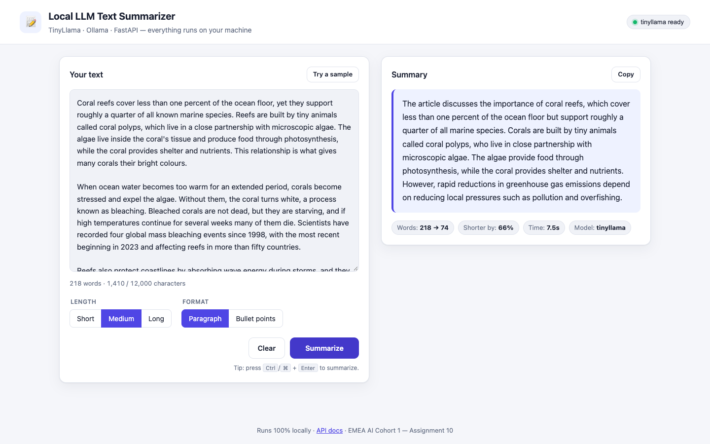
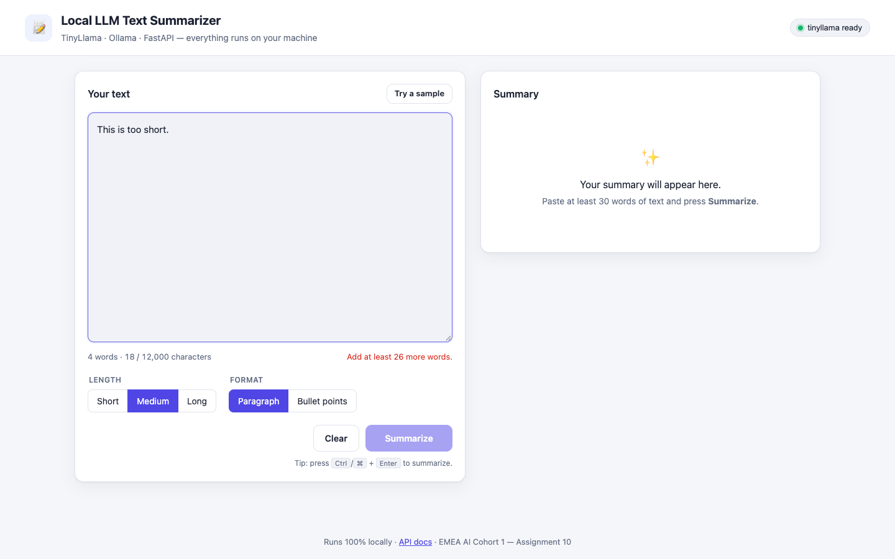
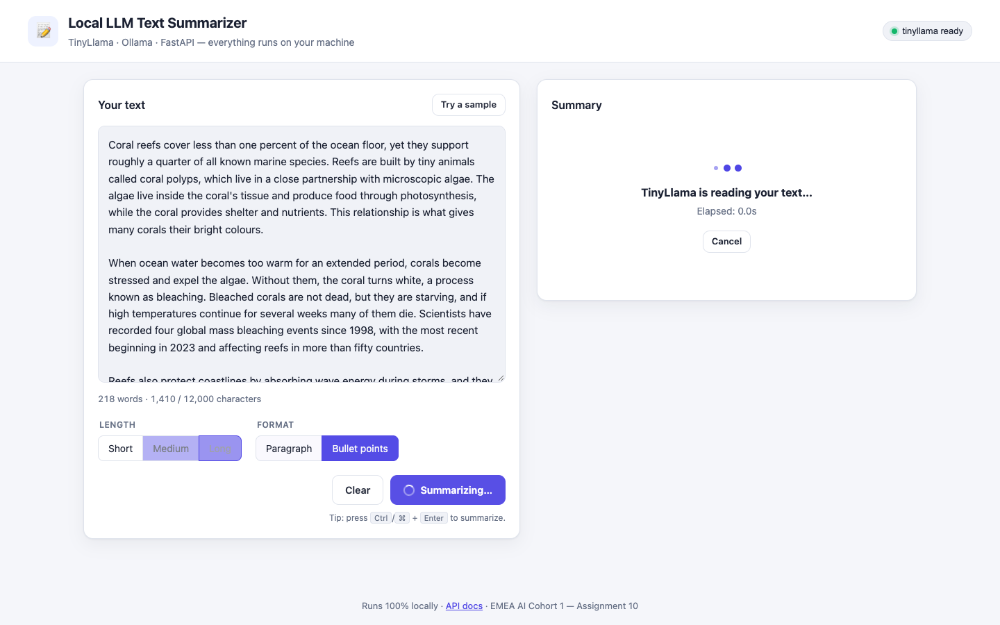
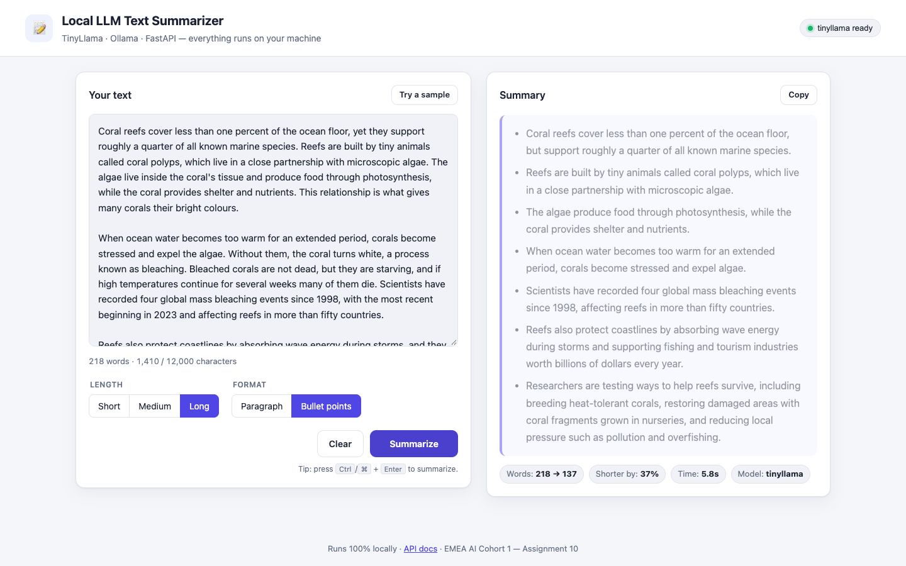

# Assignment 10 – Local LLM Text Summarizer

A text summarization web application built with **FastAPI** and **TinyLlama** running locally through **Ollama**.
Paste any text, choose the length and format, and get a concise summary. Nothing leaves your machine.



## Requirements checklist

| Requirement | Where it is implemented |
|---|---|
| Create and configure a Conda environment | [`environment.yml`](environment.yml) (Python 3.11 + pinned packages in [`requirements.txt`](requirements.txt)); [`setup.sh`](setup.sh) automates it |
| Install Ollama and pull the TinyLlama model | [Setup](#setup) below; the app checks for the model at `/api/health` |
| FastAPI endpoint that accepts text and generates a concise summary | `POST /api/summarize` in [`app/main.py`](app/main.py), logic in [`app/summarizer.py`](app/summarizer.py) |
| User-friendly HTML interface connected to the backend | [`app/static/`](app/static) (HTML + CSS + JavaScript, served at `/`) |
| Input validation, loading status, exception handling, clear error messages | [`app/schemas.py`](app/schemas.py), [`app/ollama_client.py`](app/ollama_client.py), exception handlers in `app/main.py`, loading/error states in `app/static/app.js` |

## Features

- **Summary options:** short, medium or long; paragraph or bullet points.
- **Long texts:** up to 12,000 characters. Texts that don't fit TinyLlama's 2,048-token context are split into chunks, each chunk is summarised, and the partial summaries are summarised again (map-reduce).
- **Live input checks:** a word and character counter, and the Summarize button stays disabled until the text is valid. The same rules are enforced again on the server.
- **Loading state:** a spinner and elapsed-time counter, with a Cancel button.
- **Health indicator:** shows whether Ollama is running and TinyLlama is installed.
- **Result view:** the summary plus statistics (words in → words out, % shorter, time, model), with a Copy button.
- **Clear errors:** every error is returned as `{"error": {"code", "message"}}` and shown in plain English.
- **Extras:** a "Try a sample" button, a Ctrl/⌘+Enter shortcut, dark mode, and interactive API docs at `/docs`.

## Setup

Quick start: `bash setup.sh` creates the Conda environment and pulls TinyLlama. The manual steps are:

```bash
# 1. Create and activate a Python virtual environment
# Requires Python 3.11 if specified in your environment.yml

# Windows (PowerShell)
py -3.11 -m venv .venv
.\.venv\Scripts\Activate.ps1

# 2. Install Python dependencies
python -m pip install --upgrade pip
python -m pip install -r requirements.txt

# 3. Install and run Ollama
# Install Ollama from https://ollama.com/download
ollama pull tinyllama

# Skip the following command if Ollama is already running
ollama serve

# 4. Run the app (in another terminal if ollama serve is running)
python -m uvicorn app.main:app --reload --port 8000
```


Open <http://localhost:8000>. The API documentation is at <http://localhost:8000/docs>.

Optional settings (environment variables): `OLLAMA_BASE_URL` (default `http://localhost:11434`), `OLLAMA_MODEL`
(`tinyllama`), `REQUEST_TIMEOUT` (180 s), `MIN_INPUT_WORDS` (30), `MAX_INPUT_CHARS` (12000), `CHUNK_CHARS` (3500).

## API

### `POST /api/summarize`

```bash
curl -X POST http://localhost:8000/api/summarize \
  -H "Content-Type: application/json" \
  -d '{"text": "<at least 30 words of text>", "length": "short", "format": "bullets"}'
```

| Field | Type | Values | Default |
|---|---|---|---|
| `text` | string | 30 words to 12,000 characters | required |
| `length` | string | `short`, `medium`, `long` | `medium` |
| `format` | string | `paragraph`, `bullets` | `paragraph` |

Response:

```json
{
  "summary": "- Coral reefs cover less than one percent of the ocean floor ...\n- ...",
  "format": "bullets", "length": "short", "model": "tinyllama",
  "input_words": 218, "summary_words": 48, "chunks": 1, "duration_ms": 1787
}
```

Other endpoints: `GET /api/health` (Ollama and model status) and `GET /api/config` (input limits used by the web page).

### Errors

| Situation | HTTP status | `error.code` | Example message |
|---|---|---|---|
| Empty, too short or too long text, invalid option, malformed JSON | 422 | `validation_error` | "The text is too short to summarize (5 words). Please provide at least 30 words." |
| Ollama is not running | 503 | `ollama_unavailable` | "Cannot connect to Ollama at http://localhost:11434. Make sure Ollama is installed and running (`ollama serve`)." |
| TinyLlama is not installed | 503 | `model_not_found` | "The model 'tinyllama' is not installed in Ollama. Run `ollama pull tinyllama` and try again." |
| The model is too slow | 504 | `ollama_timeout` | "The model took too long to respond…" |
| The model returns nothing usable | 502 | `empty_response` | "The model did not produce a usable summary. Please try again." |
| Anything unexpected | 500 | `internal_error` | Generic message; details are logged on the server, not leaked to the client. |

## How it works

```
Browser (HTML/CSS/JS) ── POST /api/summarize ──► FastAPI
                                                  │ 1. Pydantic validation
                                                  │ 2. split into chunks if > 3,500 chars (map-reduce)
                                                  │ 3. prompt TinyLlama via Ollama /api/chat
                                                  │ 4. clean up and shorten the output
                                                  ▼
                                          Ollama (localhost:11434) ─ TinyLlama 1.1B
```

TinyLlama has only 1.1B parameters, so the app does some extra work around the model. Each technique below was chosen after testing prompts against the model:

1. **Prompt order.** The source text comes first and the instruction last. The model follows this more reliably than an instruction placed before a long text.
2. **Low temperature (0.2) and a token limit.** Both are set per length.
3. **Output clean-up.** This removes preambles ("Sure! Here is a summary:"), echoed instructions and closing remarks. It also normalises numbered or starred lists into bullets, gives each bullet a single idea, and removes near-duplicate bullets. An unfinished last sentence is dropped only when Ollama reports that the output hit the token limit (`done_reason == "length"`).
4. **Length control.** TinyLlama writes about 110 words whatever length is requested. The app therefore keeps the most informative sentences using a SumBasic-style selection: sentences are scored by how frequent their words are in the source, and that score drops once a topic is covered, so the summary also covers new topics. The first sentence is always kept and the original order is preserved.
5. **Typo repair.** TinyLlama often garbles copied words (it consistently writes "ocena" instead of "ocean"). A summary word that isn't in the source, but is exactly one edit away from a single source word, is replaced with that word. Inflections such as "expert" → "experts" are left alone.

## Tests

```bash
pytest          # 37 tests, run offline: Ollama is replaced by a fake client
```

The tests cover validation errors, every Ollama failure mode, chunking, preamble and duplicate removal, bullet normalisation, length trimming and typo repair.

## Project structure

```
app/
  main.py            FastAPI app, routes, exception handlers
  config.py          settings from environment variables
  schemas.py         request/response models and input validation
  ollama_client.py   async Ollama client with error mapping
  summarizer.py      prompting, chunking (map-reduce), output clean-up
  static/            index.html, styles.css, app.js
samples/             example texts (including a long article that triggers chunking)
screenshots/         screenshots of the running app
tests/               pytest suite
environment.yml, requirements.txt, pytest.ini
```

## Screenshots

| Validation | Loading | Bullet-point summary |
|---|---|---|
|  |  |  |

## Limitations

TinyLlama is a very small model. Its summaries are fluent and mostly faithful, but it can occasionally merge facts or
add a detail that isn't in the source text. A larger local model would be more accurate; the app can use one by setting
`OLLAMA_MODEL`, for example to `llama3`.
