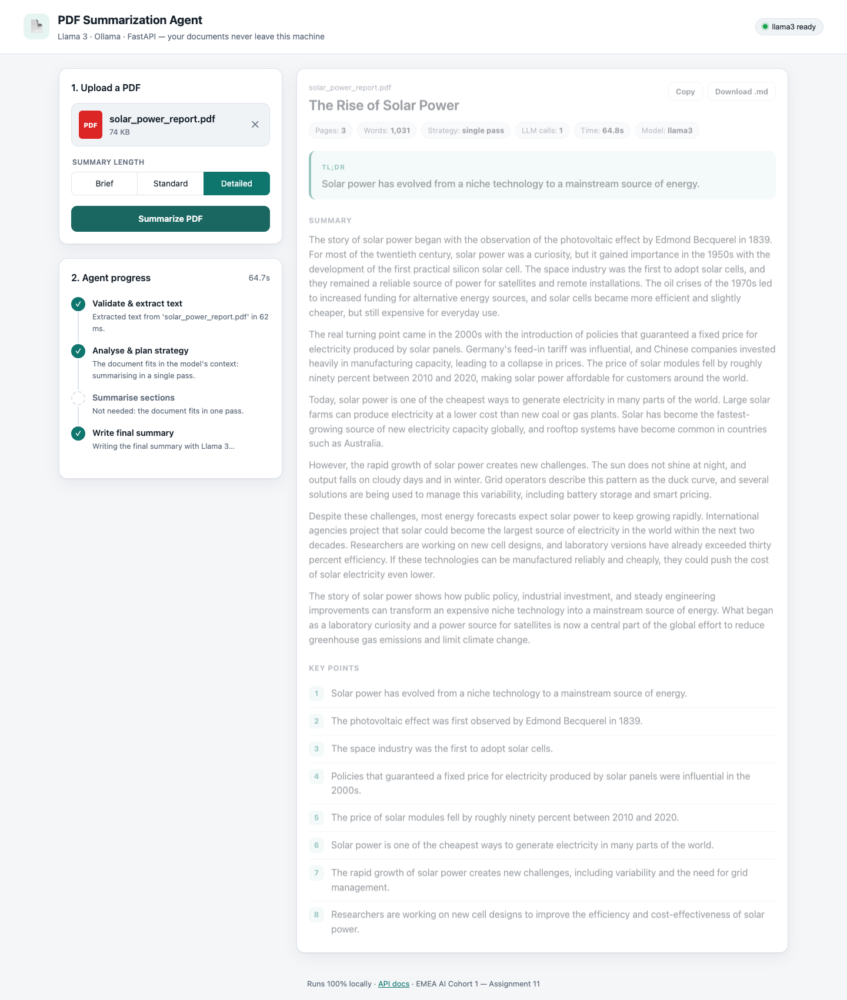
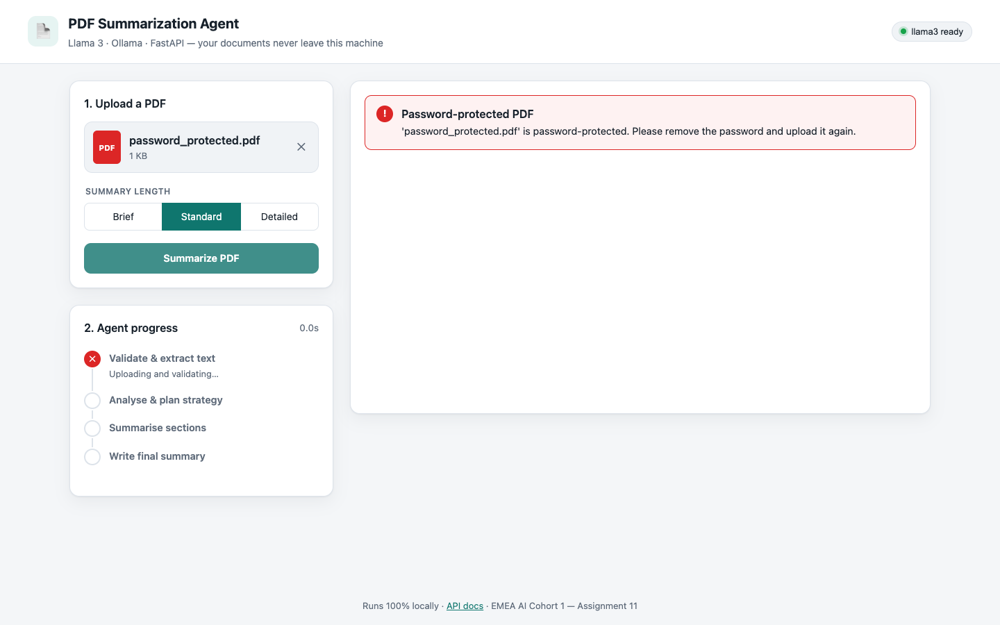
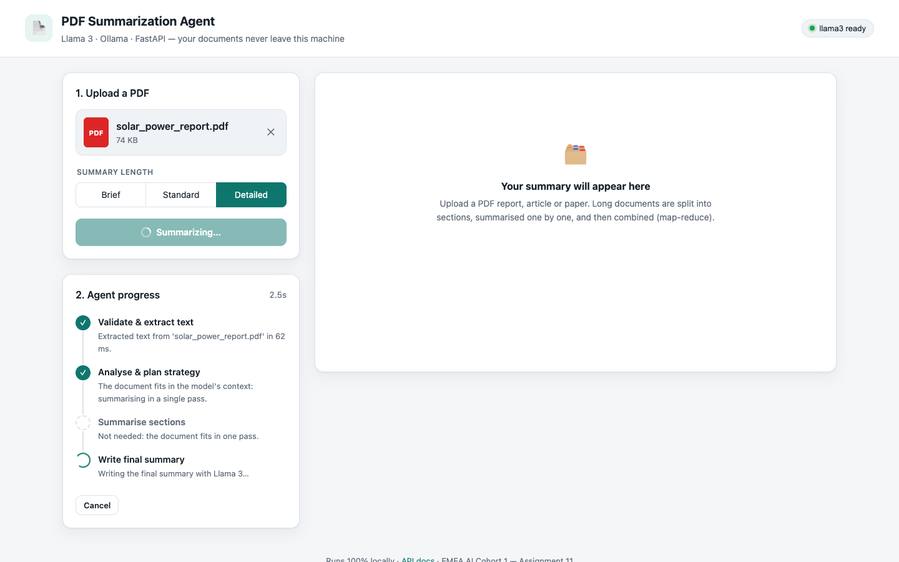

# Assignment 11 – PDF Summarization Agent with Llama 3

A PDF summarization **LLM agent** built with **FastAPI**, **Ollama** and **Llama 3 (8B)**, all running locally.
Upload a PDF and the agent validates it, extracts the text, plans a strategy based on the document's length,
summarises long documents section by section, and returns a structured summary: title, TL;DR, summary, key points
and section-by-section notes with page numbers. Progress is streamed live to the browser.



## Requirements checklist

| Requirement | Where it is implemented |
|---|---|
| Accept a PDF through a file-upload interface | Drag-and-drop upload page ([`app/static/`](app/static)) and `POST /api/summarize` / `POST /api/summarize/stream` (multipart) |
| Validate the file and extract readable text | [`app/pdf_extractor.py`](app/pdf_extractor.py): extension, size, `%PDF` header, corruption, encryption, page limit, scanned/image-only detection; text extraction with PyMuPDF and clean-up |
| Handle long documents with appropriate text segmentation | [`app/chunker.py`](app/chunker.py) (page-aware, token-budgeted, overlapping chunks) and the map-reduce plan in [`app/agent.py`](app/agent.py) |
| Generate a meaningful summary with Llama 3 through local Ollama | [`app/agent.py`](app/agent.py) + [`app/ollama_client.py`](app/ollama_client.py) (structured JSON output) |
| Display the summary clearly; handle extraction and model errors gracefully | Result view with TL;DR, paragraphs, key points, section notes, Copy / Download .md; every error has a code and a readable message |

## The agent

The agent works through explicit steps and reports each one to the UI as it goes:

| Step | What happens |
|---|---|
| 1. Validate & extract | Rejects anything that isn't a readable PDF. Extracts text block by block (keeping paragraphs intact), removes running headers/footers and page numbers, re-joins hyphenated words and normalises ligatures. |
| 2. Analyse & plan | Estimates the token count. **If the document fits Llama 3's 8k context** (≤ 5,500 estimated tokens), it is summarised in a **single pass**. Otherwise it uses **map-reduce**. |
| 3. Map | The text is split into chunks of about 3,000 tokens that follow paragraph and sentence boundaries, overlap by about 150 tokens, and record their page range. Llama 3 writes 4–8 bullet-point notes per chunk. |
| 4. Reduce | If the combined notes are still larger than the 4,500-token budget, they are merged group by group (hierarchically) until they fit. |
| 5. Synthesise | Llama 3 writes the final summary as JSON that follows a fixed schema (`title`, `tldr`, `summary`, `key_points`), using Ollama structured outputs. If the JSON is invalid it retries once, with a larger token budget if the first answer was cut off. |
| 6. Check | Normalises the output (paragraphs, de-duplicated key points, fallback title and TL;DR) and rejects incomplete answers with a clear error. |

The prompts tell the model to use only information from the document. The final prompt also requires the summary
to cover the document from beginning to end; early tests showed that Llama 3 otherwise over-weights the first sections.

Measured on an Apple M4 (16 GB):

| Document | Pages / words | Strategy | LLM calls | Time |
|---|---|---|---|---|
| `samples/solar_power_report.pdf` | 3 / 1,031 | single pass | 1 | ≈ 18–23 s |
| `samples/NIST_AI_RMF_1.0.pdf` (NIST AI Risk Management Framework, public domain) | 48 / 15,320 | map-reduce, 10 sections | 11 | ≈ 5.8 min |

## Setup

```bash
# Option A: Using Conda
conda env create -f environment.yml
conda activate a11-pdf-agent

# Option B: Without Conda (Windows)
# Run from the project root directory
py -3.11 -m venv .venv
.\.venv\Scripts\Activate.ps1

python -m pip install --upgrade pip
python -m pip install -r requirements.txt

# 2. Ollama + Llama 3 (8B, about 4.7 GB)
# Install Ollama from https://ollama.com/download
ollama pull llama3

# Skip if Ollama is already running as a service or desktop app
ollama serve

# 3. Run the app (use a second terminal if ollama serve is running)
python -m uvicorn app.main:app --port 8000
```

**Notes:**
- Install Python 3.11 if required by `environment.yml`.
- Ensure `requirements.txt` exists in the project root.
- Install Ollama separately; it is not a Python package.
- Llama 3 requires downloading approximately 4.7 GB of model data.
- If PowerShell blocks virtual-environment activation, use Command Prompt and run `.venv\Scripts\activate.bat`.
- Open [http://localhost:8000](http://localhost:8000) after the server starts.
- If Ollama is already running, skip `ollama serve` to avoid a port conflict.


Open <http://localhost:8000> (API docs at `/docs`). Settings can be changed with environment variables: `OLLAMA_BASE_URL`,
`OLLAMA_MODEL` (`llama3`), `REQUEST_TIMEOUT` (300 s), `MAX_FILE_MB` (20), `MAX_PAGES` (300), `SINGLE_PASS_TOKENS` (5500),
`CHUNK_TOKENS` (3000), `CHUNK_OVERLAP_TOKENS` (150), `NOTES_BUDGET_TOKENS` (4500).

## API

```bash
# Complete result as JSON
curl -F "file=@samples/solar_power_report.pdf" -F "length=standard" http://localhost:8000/api/summarize

# Same, but streams progress events as NDJSON (one JSON object per line) – used by the web page
curl -N -F "file=@samples/NIST_AI_RMF_1.0.pdf" http://localhost:8000/api/summarize/stream
```

`length` is `brief` (one paragraph, 4 key points), `standard` (two paragraphs, 6 key points) or `detailed`
(3–4 paragraphs, 8 key points). The response looks like this:

```json
{
  "title": "The Rise of Solar Power",
  "tldr": "Solar power has evolved from a curiosity to a mainstream source of energy.",
  "summary": "paragraph 1\n\nparagraph 2",
  "key_points": ["...", "..."],
  "sections": [{"start_page": 1, "end_page": 8, "notes": ["...", "..."]}],
  "length": "standard",
  "document": {"filename": "...", "pages": 3, "words": 1031, "title": "...", "skipped_pages": []},
  "stats": {"model": "llama3", "strategy": "single-pass", "chunks": 1, "llm_calls": 1, "extraction_ms": 10, "summarization_ms": 18722}
}
```

Stream events: `{"type":"progress","stage":"mapping","message":"Summarising section 3 of 10 (pages 12–18)","current":3,"total":10}`,
followed by `{"type":"result","data":{…}}` or `{"type":"error","error":{"code","message"}}`. If the browser disconnects, the server cancels the work.

### Error handling

| Problem | Status | `error.code` |
|---|---|---|
| No file uploaded | 400 / 422 | `no_file` / `validation_error` |
| Not a `.pdf`, or a `.pdf` without a PDF header | 415 | `invalid_file_type` |
| Empty file | 400 | `empty_file` |
| Larger than 20 MB | 413 | `file_too_large` |
| Corrupted PDF | 422 | `corrupt_pdf` |
| Password-protected PDF | 422 | `encrypted_pdf` |
| More than 300 pages | 422 | `too_many_pages` |
| Scanned or image-only PDF (fewer than 50 words of text) | 422 | `no_extractable_text` |
| Ollama not running / model missing | 503 | `ollama_unavailable` / `model_not_found` |
| Model timeout / invalid model output | 504 / 502 | `model_timeout` / `invalid_model_output` |

The web page also checks the file type and size before uploading, and shows which agent step failed.
`samples/invalid/` contains a password-protected PDF, a scanned image-only PDF and a fake PDF for trying these cases.

## Tests

```bash
pytest          # 42 tests, run offline with generated PDFs and a fake LLM client
```

The tests cover upload validation, header/footer removal, hyphenation and ligature clean-up, encrypted, scanned and
corrupt PDFs, chunk size, overlap and page tracking, single-pass vs map-reduce planning, hierarchical reduction,
output normalisation, NDJSON streaming and every API error path.

## Project structure

```
app/
  main.py            FastAPI routes (JSON + NDJSON streaming), error handlers
  agent.py           the summarization agent (analyse, plan, map, reduce, synthesise, check)
  chunker.py         page-aware, token-budgeted, overlapping segmentation
  pdf_extractor.py   upload validation and text extraction/clean-up (PyMuPDF)
  ollama_client.py   async Ollama client: chat, structured JSON output, error mapping
  schemas.py, config.py
  static/            index.html, styles.css, app.js
samples/             solar_power_report.pdf, NIST_AI_RMF_1.0.pdf, invalid/ (error-case PDFs)
scripts/make_sample_pdfs.py   regenerates the sample PDFs
screenshots/, tests/
```

## Screenshots

| Encrypted PDF rejected | Live agent progress |
|---|---|
|  |  |
