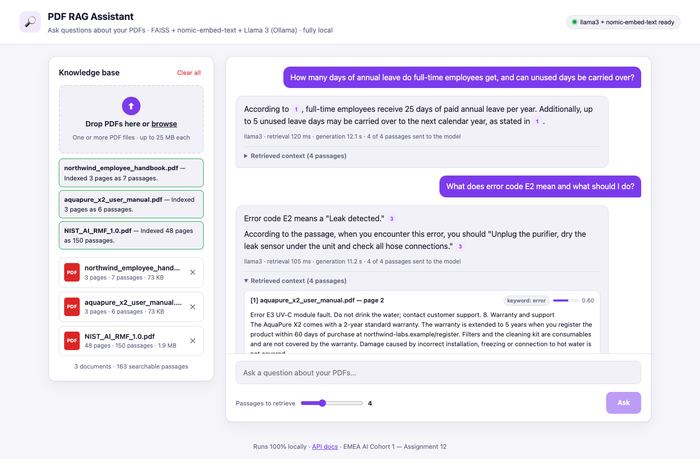
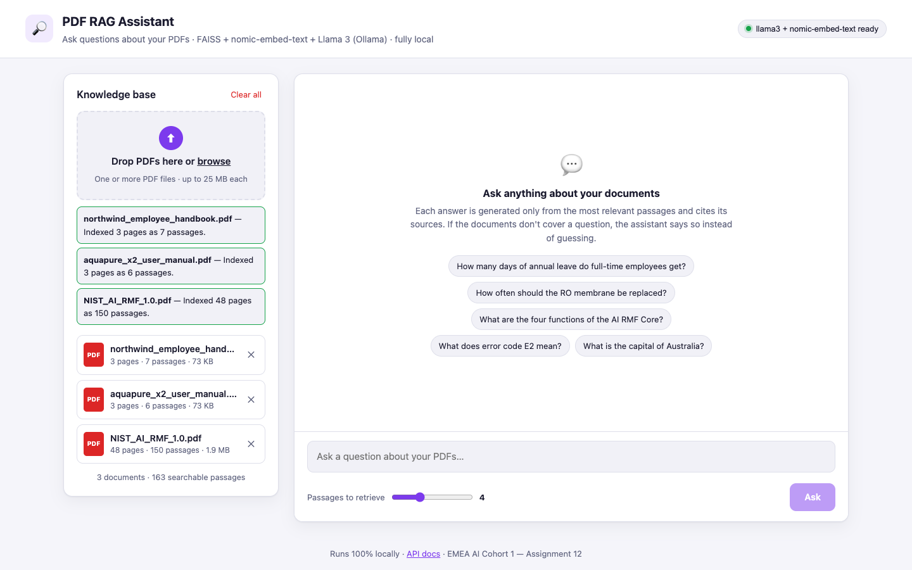
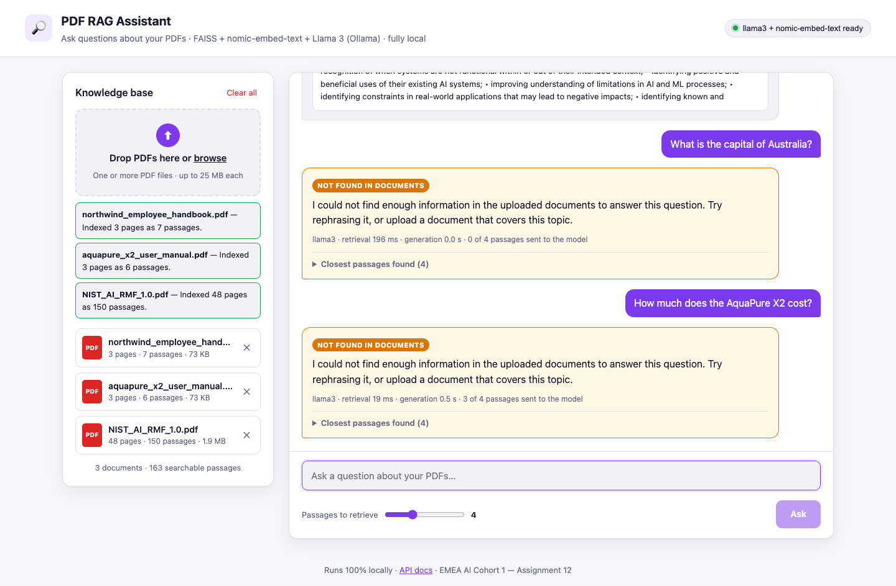

# Assignment 12 – PDF-Based Retrieval-Augmented Generation (RAG) Application

A complete RAG application that uses **your PDF documents as its knowledge source** and a **locally hosted LLM
(Llama 3 via Ollama)** to answer questions. It returns each answer **with the passages it was based on** (with
citations, page numbers and similarity scores) and **answers safely when the documents don't contain enough
information**.



## Requirements checklist

| Requirement | Where it is implemented |
|---|---|
| Upload one or more PDF documents and extract their text | Multi-file upload page and `POST /api/documents`; validation and extraction in [`app/pdf_extractor.py`](app/pdf_extractor.py) (PyMuPDF) |
| Split the content into manageable chunks and create a searchable index | [`app/chunker.py`](app/chunker.py) (about 1,000-character, page-bounded, overlapping chunks); [`app/vector_store.py`](app/vector_store.py) (FAISS vector index, saved to disk) + [`app/lexical.py`](app/lexical.py) (BM25 keyword index) |
| Retrieve the most relevant chunks for each question | Hybrid search: vector similarity + BM25, merged with Reciprocal Rank Fusion, then a relevance check ([`app/rag.py`](app/rag.py)) |
| Pass only the retrieved context and the question to the local LLM through Ollama | `build_messages()` in [`app/rag.py`](app/rag.py): the prompt contains only the numbered retrieved passages and the question (no chat history) |
| Return the answer with the retrieved context; respond safely when the information is missing | `POST /api/ask` returns `answer`, `status` and `sources[]`. Safe refusal has two layers (see below). |

## How it works

```
Indexing   PDF ─► validate ─► extract text per page ─► chunks (≈1,000 chars, never spanning pages, 150-char overlap)
               ─► nomic-embed-text embeddings ("search_document:" prefix) ─► FAISS IndexFlatIP (cosine) + BM25
               ─► saved to data/index.faiss + data/store.json

Answering  question ─► embedding ("search_query:" prefix)
               ├─► FAISS: most similar passages ─┐
               └─► BM25: keyword matches ─────────┴─► Reciprocal Rank Fusion ─► top-k passages
           ─► relevance check (cosine ≥ 0.55, or a rare keyword such as "E2" matched and cosine ≥ 0.40)
           ─► none relevant?  ─► safe "not enough information" answer (no LLM call)
           ─► Llama 3 with ONLY the relevant passages + the question
           ─► model replies INSUFFICIENT_CONTEXT? ─► safe "not enough information" answer
           ─► otherwise: answer with [n] citations + all retrieved passages
```

**Why hybrid retrieval?** Embeddings capture meaning but are weak at exact tokens. The question *"What does error
code E2 mean and what should I do?"* did not retrieve the E2 troubleshooting row with vector search alone. BM25
finds such exact matches (error codes, part numbers, names), and rank fusion keeps the best of both.

**Safe answers have two layers:**

1. **Retrieval threshold.** If no passage is relevant, the app doesn't call the LLM at all. It replies that the
   documents don't contain the information, and still shows the closest passages for transparency. Off-topic
   questions such as "What is the capital of Australia?" score about 0.51 against the samples, while answerable
   questions score 0.59–0.87, hence the 0.55 threshold.
2. **The LLM's own check.** On-topic questions that the documents don't answer ("How much does the AquaPure X2
   cost?") get high similarity scores, around 0.72. For these, the system prompt tells Llama 3 to reply exactly
   `INSUFFICIENT_CONTEXT`, which the app turns into the same safe answer.

The system prompt also requires a citation for every statement and tells the model to ignore any instructions that
appear inside the documents (a basic defence against prompt injection).

## Evaluation

`python scripts/evaluate_rag.py` indexes the sample PDFs and asks 16 answerable and 6 unanswerable questions. Full
details are in [`reports/rag_evaluation.md`](reports/rag_evaluation.md).

| Metric | Result |
|---|---|
| Retrieval hit rate (answer page retrieved and judged relevant) | **16 / 16** |
| Answer accuracy (answered and mentions the expected facts) | **16 / 16** |
| Safe refusals for questions the documents don't cover | **6 / 6** |

## Setup

```bash
# Option A: Using Conda
conda env create -f environment.yml
conda activate a12-pdf-rag

# Option B: Without Conda (Windows)
# Run from the project root directory
py -3.11 -m venv .venv
.\.venv\Scripts\Activate.ps1

python -m pip install --upgrade pip
python -m pip install -r requirements.txt

# 2. Ollama + Llama 3 and embedding model
# Install Ollama from https://ollama.com/download

ollama pull llama3              # answer generation (about 4.7 GB)
ollama pull nomic-embed-text    # embeddings (about 270 MB)

# Skip if Ollama is already running as a service / desktop app
ollama serve

# 3. Run the app (use a second terminal if ollama serve is running)
python -m uvicorn app.main:app --port 8000
```


Open <http://localhost:8000>, upload the PDFs from `samples/` (or your own) and ask questions. API docs are at `/docs`.
The index is stored in `data/` and reloaded on restart.

The sample knowledge base contains:

- `northwind_employee_handbook.pdf` and `aquapure_x2_user_manual.pdf`. These describe a fictional company and product,
  so the LLM can't answer from its training data. This makes it easy to check that answers come from the documents.
  They can be regenerated with `scripts/make_sample_pdfs.py`.
- `NIST_AI_RMF_1.0.pdf`, the 48-page NIST AI Risk Management Framework (a public-domain US government publication).

Settings (environment variables): `LLM_MODEL` (`llama3`), `EMBEDDING_MODEL` (`nomic-embed-text`), `TOP_K` (4),
`MIN_SIMILARITY` (0.55), `CHUNK_CHARS` (1000), `CHUNK_OVERLAP_CHARS` (150), `MAX_FILE_MB` (25), `DATA_DIR` (`data/`).

## API

| Method & path | Purpose |
|---|---|
| `POST /api/documents` | Upload one or more PDFs (`files` field). Returns a result for each file: `indexed`, `duplicate` (same SHA-256 already indexed) or `error` with a message. The status is 200, 207 if some files failed, or the error status if all failed. |
| `GET /api/documents` | List indexed documents (pages, passages, size). |
| `DELETE /api/documents/{id}` | Remove one document and its passages from the index. |
| `DELETE /api/documents` | Clear the knowledge base. |
| `POST /api/ask` | `{"question": "...", "top_k": 4}` returns the answer, its status and sources (see below). |
| `GET /api/health`, `GET /api/config` | Model status and settings. |

```json
{
  "question": "What does error code E2 mean and what should I do?",
  "answer": "Error code E2 means a \"Leak detected.\" [3] ... unplug the purifier, dry the leak sensor ... [3]",
  "status": "answered",
  "sources": [
    {"rank": 3, "filename": "aquapure_x2_user_manual.pdf", "page": 2, "score": 0.547,
     "relevant": true, "keyword_match": ["code", "e2", "error"], "cited": true, "text": "..."}
  ],
  "model": "llama3", "retrieval_ms": 45, "generation_ms": 6120
}
```

`status` is `answered`, `insufficient_context` (safe answer) or `no_documents`. Upload and model errors use the format
`{"error": {"code", "message"}}`: `invalid_file_type` (415), `file_too_large` (413), `encrypted_pdf`,
`no_extractable_text` or `corrupt_pdf` (422), `duplicate_document` (409), `ollama_unavailable` or `model_not_found` (503),
`model_timeout` (504), `validation_error` (422) for empty, too short or too long questions.

## Tests

```bash
pytest          # 22 tests, run offline with a fake Ollama client (deterministic toy embeddings)
```

The tests cover chunking, FAISS search, delete and persistence, BM25 and the hybrid keyword rescue, prompt contents
(only the retrieved passages and the question), citation parsing, both safe-answer layers, duplicate and invalid
uploads, mixed upload results, question validation, and Ollama outages.

## Project structure

```
app/
  main.py           FastAPI routes and error handling
  rag.py            ingestion and question answering (retrieval, prompt, safe answers, citations)
  vector_store.py   FAISS index + metadata, hybrid search with rank fusion, saved to disk
  lexical.py        BM25 keyword index
  chunker.py        page-bounded overlapping chunks
  pdf_extractor.py  PDF validation and text extraction
  ollama_client.py  embeddings + chat via Ollama, error mapping
  schemas.py, config.py, static/ (index.html, styles.css, app.js)
samples/            sample knowledge-base PDFs
scripts/            make_sample_pdfs.py, evaluate_rag.py
reports/            rag_evaluation.md / .json
screenshots/, tests/, data/ (created at runtime)
```

## Screenshots

| Knowledge base | Safe refusal when the answer isn't in the documents |
|---|---|
|  |  |
